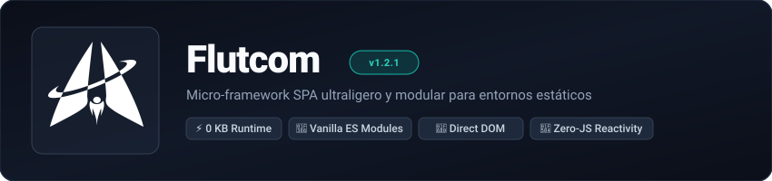

<p align="center">
  <a href="https://mrblour.github.io/Flutcom/">
    
  </a>
</p>

<div align="center">

[](LICENSE)
[](#)
[](#)
[](#)
[](https://mrblour.github.io/Flutcom/)

</div>

<p align="center">
  <a href="https://mrblour.github.io/Flutcom/">🌐 <strong>Ver Demo en Vivo</strong></a> •
  <a href="https://vercel.com/new/clone?repository-url=https%3A%2F%2Fgithub.com%2FMrblour%2FFlutcom">▲ <strong>Desplegar en Vercel</strong></a> •
  <a href="https://mrblour.github.io/doc-flutcom/#docs">📖 <strong>Documentación Oficial</strong></a>
</p>

---

## ¿Por qué Flutcom?

Flutcom nació para resolver un problema cotidiano: cuando quieres construir una Single Page Application (SPA) interactiva para hostings estáticos (como GitHub Pages, Vercel o Netlify), los frameworks tradicionales te obligan a instalar cientos de megabytes en `node_modules`, configurar bundlers complejos y pagar la sobrecarga de un Virtual DOM.

Flutcom ofrece enrutamiento SPA por hash, componentes reutilizables con slots, directivas reactivas en HTML (`fc-model`) y un almacén global en **puro JavaScript moderno (ES Modules)**, con **0 dependencias de runtime**.

### Comparativa técnica objetiva

| Aspecto | ⚡ Flutcom | React | Vue | Vanilla JS clásico |
| :--- | :--- | :--- | :--- | :--- |
| **Peso en runtime** | **0 KB** (sin dependencias) | ~140 KB (`react` + `react-dom`) | ~90 KB (`vue` runtime) | 0 KB |
| **Arquitectura DOM** | **DOM nativo directo** | Virtual DOM con diffing | Virtual DOM con Proxies | Manipulación manual directa |
| **Enrutador SPA** | **Nativo por hash integrado** (`#home`) | Requiere librería (`react-router`) | Requiere librería (`vue-router`) | Sin enrutador (código a mano) |
| **Reactividad** | **Directivas HTML** (`fc-model`, `fc-bind`) | Estado y Hooks (`useState`) | Directivas reactivas (`v-model`) | Event listeners y `innerHTML` manual |
| **Paso de compilación** | **Opcional** (corre directo en navegador) | Obligatorio (JSX / Vite / Babel) | Obligatorio (`.vue` compiler) | Ninguno |
| **Curva de aprendizaje** | **Mínima** (HTML, CSS y JS estándar) | Moderada a empinada | Moderada | Baja |
| **Ideal para** | Sitios estáticos, landings, micro-SPAs, dashboards | Aplicaciones web masivas y plataformas corporativas | Aplicaciones web medianas a grandes | Scripts simples de una página |

---

## Inicio Rápido (30 segundos)

Crea un proyecto nuevo con la CLI oficial:

```bash
npm create flutcom@latest
```

O clona este repositorio directamente:

```bash
git clone https://github.com/Mrblour/Flutcom.git mi-app
cd mi-app
npm install
npm run dev
```

### Comandos de desarrollo

| Comando | Función |
| :--- | :--- |
| `npm run dev` | Inicia el servidor de desarrollo local con recarga en vivo y compilación continua de Tailwind CSS. |
| `npm run build` | Compila y minifica los estilos y empaqueta los archivos estáticos listos para producción en la carpeta `dist/`. |
| `npm run preview` | Levanta un servidor local estático para probar la versión compilada de `dist/`. |

---

## Cómo se programa en Flutcom

### 1. Componentes con proyección de slots y reactividad declarativa
```html
<!-- Componente reutilizable con directivas reactivas integradas -->
<flut-card title="Mi Perfil">
  <!-- fc-model sincroniza automáticamente con el estado global -->
  <input fc-model="usuario" placeholder="Escribe tu nombre..." />
  
  <!-- fc-bind refleja el valor reactivo en tiempo real -->
  <p>Hola, <strong fc-bind="usuario">Visitante</strong></p>

  <button fc-click="Flut.toast('¡Perfil guardado!')">Guardar</button>
</flut-card>
```

### 2. Enrutamiento declarativo (`flutcom.config.js`)
```javascript
export const routes = {
  home:    { view: "resources/views/home.html",    title: "Inicio" },
  about:   { view: "resources/views/about.html",   title: "Nosotros" },
  contact: { view: "resources/views/contact.html", title: "Contacto" }
};
```

### 3. Helper global unificado (`Flut`)
```javascript
// Navegación programática
Flut.go('about');

// Estado reactivo global
Flut.set('tema', 'oscuro');
const temaActual = Flut.get('tema');

// Notificaciones flotantes instantáneas
Flut.toast('Operación realizada con éxito');
```

---

## Despliegue

Dado que Flutcom genera archivos estáticos puros y utiliza navegación por hash (`#home`, `#about`), funciona en cualquier proveedor de hosting estático sin requerir configuración especial de reescritura de URLs en el servidor.

### Desplegar en Vercel con 1-Click

[](https://vercel.com/new/clone?repository-url=https%3A%2F%2Fgithub.com%2FMrblour%2FFlutcom)

#### Configuración recomendada para Vercel:
- **Build Command:** `npm run build`
- **Output Directory:** `dist`
- **Install Command:** `npm install`

*(El archivo `vercel.json` ya se incluye en la raíz del proyecto para preconfigurar estos valores de manera automática).*

---

## Documentación y Recursos

Para consultar la referencia completa de la API, guías paso a paso y arquitectura del framework:

👉 **[Sitio de Documentación Oficial de Flutcom](https://mrblour.github.io/doc-flutcom/#docs)**  
👉 **[Wiki en GitHub](https://github.com/Mrblour/Flutcom/wiki)**

- [Guía de Creación de Componentes HTML](https://github.com/Mrblour/Flutcom/wiki/Components)
- [Referencia de Directivas Reactivas (`fc-*`)](https://github.com/Mrblour/Flutcom/wiki/Directives)
- [Sistema de Plugins Nativos Zero-Code](https://github.com/Mrblour/Flutcom/wiki/Plugins)
- [Ciclo de Vida y Protección de Rutas](https://github.com/Mrblour/Flutcom/wiki/Routing)

---

## Licencia

Distribuido bajo la licencia [MIT](LICENSE). Código libre y abierto para proyectos personales y comerciales.
