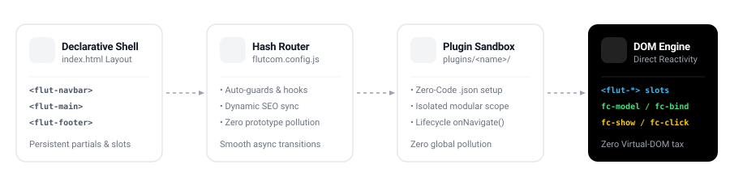

<p align="center">
  
</p>

# Flutcom

<p align="center">
  <strong>Ultra-fast, zero-dependency SPA micro-framework for static environments.</strong>
  <br/>
  Pure HTML5, CSS, and modern Vanilla ES Modules. No Virtual DOM. Zero runtime tax.
  <br/><br/>
</p>

<div align="center">

[](LICENSE)
[](#)
[](#)
[](#)
[](#security--hardening)
[](#ai-native-architecture)
[](https://flutcom.vercel.app/)

</div>

<p align="center">
  <a href="https://flutcom.vercel.app/">🌐 <strong>View Live Demo</strong></a> •
  <a href="https://vercel.com/new/clone?repository-url=https%3A%2F%2Fgithub.com%2FMrblour%2FFlutcom">▲ <strong>Deploy to Vercel</strong></a> •
  <a href="https://github.com/Mrblour/Flutcom/wiki">📖 <strong>Explore the Wiki</strong></a>
</p>

---

<p align="center">
  
</p>

---

## Why Flutcom? (Comparison)

| Feature | ⚡ Flutcom | ⚛️ React | 💚 Vue | 🍦 Vanilla JS |
| :--- | :---: | :---: | :---: | :---: |
| **Runtime Bundle Size** | **0 KB** (Zero) | ~140 KB | ~90 KB | 0 KB |
| **External Dependencies** | **0 runtime deps** | 1,000+ (`node_modules`) | 1,000+ | 0 |
| **Virtual DOM Diffing** | 🚀 **Direct Native DOM** | Heavy V-DOM | Heavy V-DOM | Direct |
| **Build Step Required?** | ❌ **No (Optional)** | ✅ Mandatory | ✅ Mandatory | ❌ No |
| **Declarative Reactivity** | ✅ **Zero-JS (`fc-model`)** | ⚠️ Complex hooks/state | ⚠️ Requires `<script>` | ❌ Manual listeners |
| **Component Syntax** | ✅ **Native `<flut-*>` & slots** | ✅ JSX | ✅ SFC (`.vue`) | ❌ Verbose WebComponents |
| **Plugin Isolation** | ✅ **Zero-Code (`.json`)** | ⚠️ Global npm packages | ⚠️ Plugins | ❌ Global script tags |
| **Learning Curve** | 🟢 **10 minutes** | 🔴 Steep | 🟡 Medium | 🟡 Moderate |

---

## Quick Start (30 Seconds)

Create a brand new Flutcom project with our official interactive CLI:

```bash
npm create flutcom@latest
```

Or clone directly:

```bash
git clone https://github.com/Mrblour/Flutcom.git my-app
cd my-app
npm install
npm run dev
```

### Essential Commands

| Command | Purpose |
| :--- | :--- |
| `npm run dev` | Starts live-reloading dev server with Tailwind CSS watch mode. |
| `npm run build` | Compiles Tailwind, optimizes assets, and outputs production bundle to `dist/`. |
| `npm run preview` | Spins up a local static server to test the production `dist/` build. |

---

## Core Taste in 60 Seconds

### 1. Declarative Layout (`index.html`)
```html
<div class="app-shell">
  <flut-navbar></flut-navbar>
  <flut-main role="main" aria-live="polite"></flut-main>
  <flut-footer></flut-footer>
</div>
```

### 2. Components & Zero-JS Two-Way Reactivity
```html
<!-- Reusable component with slot projection -->
<flut-card title="Account Settings">
  <input fc-model="username" placeholder="Enter username..." />
  <p>Logged in as: <strong fc-bind="username">guest</strong></p>

  <div fc-show="username">Welcome back!</div>
  <button fc-click="Flut.toast('Profile updated!')">Save</button>
</flut-card>
```

### 3. Unified Global Helper
```javascript
// Navigate programmatically
Flut.go('home');

// Reactive Store
Flut.set('theme', 'dark');
Flut.get('theme');

// Instant UI notifications
Flut.toast('Operation completed!');
```

---

## Ecosystem & Features

- 🧩 **Zero-Code Native Plugins**: Drop-in plugins in `plugins/<name>/` configured completely via `<name>.flutcom.json` with lifecycle hooks (`onNavigate`) and zero global pollution.
- 🛡️ **Hardened & Audited**: Built-in immunity against DOM XSS in component props, CSS selector injection, and prototype collisions.
- 🎯 **Automatic Per-Route SEO**: Dynamic `<title>`, description, and OpenGraph sync on every route navigation.
- 🤖 **AI-Agent Ready**: Pre-configured guidelines, architectural rules, and operational skills in [`.agents/`](.agents/README.md) for Antigravity, Claude Code, Cursor, and Copilot.

---

## 🚀 Instant Deployment (Vercel)

Flutcom is designed to be 100% static and edge-ready. Deploy your own instance directly to **Vercel** in seconds with zero configuration.

### 1-Click Deploy

[](https://vercel.com/new/clone?repository-url=https%3A%2F%2Fgithub.com%2FMrblour%2FFlutcom)

### Deploy via Vercel CLI

```bash
# 1. Install Vercel CLI
npm i -g vercel

# 2. Deploy preview
vercel

# 3. Deploy to production
vercel --prod
```

### Recommended Vercel Settings

| Setting | Value |
| :--- | :--- |
| **Framework Preset** | `Other` |
| **Build Command** | `npm run build` |
| **Output Directory** | `dist` |
| **Install Command** | `npm install` |

> ⚡ **Edge Optimized**: Thanks to Flutcom's native SPA hash router (`#route`), your application works out of the box on Vercel's Edge Network with 0ms cold starts and zero server rewriting required.

---

## 📚 Official Documentation & Wiki

Detailed guides, API reference, and walkthroughs are maintained in our Wiki:

👉 **[Read the Flutcom Wiki](https://github.com/Mrblour/Flutcom/wiki)**

- [Creating Custom HTML Components](https://github.com/Mrblour/Flutcom/wiki/Components)
- [Developing Zero-Code Native Plugins](https://github.com/Mrblour/Flutcom/wiki/Plugins)
- [Reactive Directives Reference (`fc-*`)](https://github.com/Mrblour/Flutcom/wiki/Directives)
- [Route Guards & Navigation Lifecycle](https://github.com/Mrblour/Flutcom/wiki/Routing)

---

## Contributing & License

Contributions, issues, and feature requests are welcome!

Flutcom is open-source software licensed under the [MIT License](LICENSE).
